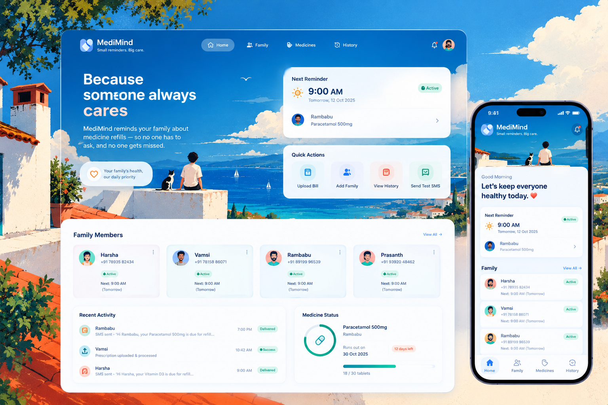

<div align="center">



<br />

# MediMind

### Small reminders. Big care.

A beautiful, family-focused medication reminder and refill management platform that helps make sure important medicines are never forgotten.

<br />

[](https://nextjs.org/)
[](https://www.typescriptlang.org/)
[](https://fastapi.tiangolo.com/)
[](https://www.sqlite.org/)
[](https://web.dev/progressive-web-apps/)
[](https://apscheduler.readthedocs.io/)

<br />

**MediMind is not a replacement for medical advice. It is a reminder and family-care tool designed to help users stay on top of medicine refills and scheduled reminders.**

</div>

---

## 🌿 What is MediMind?

MediMind was built around a simple problem:

> **Sometimes the hardest part of taking care of someone is simply remembering.**

Families often know that a medicine needs to be refilled, but busy schedules, work, travel and everyday life can make those reminders easy to miss.

MediMind turns that responsibility into a lightweight automated workflow.

It keeps track of family members, medicines, refill dates and reminder history, then automatically sends warm SMS reminders at the configured times — without requiring the dashboard to remain open in a browser.

### The idea

```text
Prescription / Bill
        ↓
   AI Extraction
        ↓
 Medicine + Quantity
        ↓
 Calculate Run-out Date
        ↓
 Activate Reminder Cycle
        ↓
  Scheduler (IST)
        ↓
   SMS Reminder
        ↓
      Family
```

---

## ✨ Features

### 💊 Medicine & Refill Management

- Add and manage family members
- Track medicines and refill information
- Calculate expected run-out dates
- Keep active and inactive reminder cycles separate
- Automatically reset an old reminder cycle when a new prescription or bill is uploaded

### ⏰ Automated Reminders

- Default reminder windows: **9:00 AM and 7:00 PM IST**
- Runs from the backend scheduler
- Does not depend on the browser being open
- Respects the medicine run-out date
- Automatically continues reminders after the run-out date until the refill cycle is updated

### 📱 SMS Automation

- Sends reminders through an Android SMS Gateway
- Uses a real SIM-backed Android device as the SMS transport
- Supports a **Send Test SMS** action
- Handles gateway failures gracefully
- Retries temporary failures with exponential backoff
- Fast-fails permanent `4xx` errors
- Stores SMS attempts and their status for traceability

### 🧠 AI-Assisted Refill Updates

Upload a prescription or medicine bill and MediMind can extract useful information such as:

- Medicine name
- Quantity
- Dosage information
- Refill information

The extracted information can then be used to calculate the next expected run-out date and reset the active reminder cycle.

### 🛡️ Reliability First

MediMind is designed around a few important rules:

- No duplicate reminder for the same recipient, date and time
- Persistent reminder state
- Safe retry handling
- Graceful handling of invalid phone numbers
- Graceful handling of an unavailable SMS gateway
- Scheduler recovery after backend restart
- Timezone-aware scheduling using `Asia/Kolkata`
- Reminder state is not tied to the browser session

---

## 🖥️ Dashboard

The dashboard is designed to make the important information visible at a glance.

### Home / Overview

See:

- Next reminder
- Active reminders
- Medicine run-out dates
- Overdue days
- Last SMS status
- Gateway/system status
- Recent errors

### Family

Manage the people whose medication reminders are being tracked.

### Medicines

View medicine information, refill state and reminder status.

### History

Inspect previous reminder and SMS activity rather than relying on guesswork when something goes wrong.

### Quick Actions

- Upload Bill
- Add Family Member
- View History
- Send Test SMS

---

## 🏗️ Architecture

```text
┌─────────────────────────────────────────────────────────────┐
│                        MediMind PWA                         │
│                 Next.js + TypeScript + UI                  │
└────────────────────────────┬────────────────────────────────┘
                             │ HTTP / SSE / Polling
                             ▼
┌─────────────────────────────────────────────────────────────┐
│                       FastAPI Backend                       │
│                                                             │
│  Family API • Medicine API • CSV Sync • AI Extraction       │
│  Reminder Engine • SMS Service • Health / Status            │
└───────────────┬───────────────────────┬─────────────────────┘
                │                       │
                ▼                       ▼
       ┌─────────────────┐      ┌─────────────────────┐
       │ SQLite +        │      │ APScheduler         │
       │ SQLAlchemy      │      │ Asia/Kolkata        │
       └─────────────────┘      └──────────┬──────────┘
                                           │
                                           ▼
                                ┌─────────────────────┐
                                │ Android SMS Gateway │
                                │ Redmi Note 8 Pro    │
                                │ SIM-backed SMS      │
                                └──────────┬──────────┘
                                           │
                                           ▼
                                      Recipient
```

---

## 🧰 Tech Stack

| Layer | Technology |
|---|---|
| Frontend | Next.js 14, TypeScript, Tailwind CSS, shadcn/ui |
| PWA | Service Worker / installable PWA |
| Backend | FastAPI, Python |
| Database | SQLite + SQLAlchemy |
| Scheduling | APScheduler |
| Realtime UI | Lightweight polling / SSE |
| AI | Existing Claude / Anthropic integration |
| SMS | Android SMS Gateway |
| HTTP Client | httpx |
| Configuration | `.env` |
| Timezone | `Asia/Kolkata` |

---

## 📂 Project Structure

```text
MediMind/
│
├── frontend/                 # Next.js PWA
│   ├── app/
│   ├── components/
│   ├── public/
│   └── ...
│
├── backend/                  # FastAPI application
│   ├── app/
│   ├── services/
│   ├── scheduler/
│   └── ...
│
├── data/                     # Local application data
├── reminders.csv             # Optional reminder import source
├── .env.example              # Environment configuration template
└── README.md
```

> Directory names may vary slightly depending on the current repository layout. Keep secrets, local databases and generated files out of version control.

---

## 🚀 Getting Started

### 1. Clone the repository

```bash
git clone <your-repository-url>
cd MediMind
```

### 2. Configure the backend

Create your environment file:

```bash
cp .env.example .env
```

Configure the required values for the database, AI provider and SMS gateway.

Example SMS configuration:

```env
SMS_GATEWAY_URL=http://<ANDROID_GATEWAY_IP>:8080/messages
SMS_GATEWAY_USERNAME=sms
SMS_GATEWAY_PASSWORD=your_password
```

**Never commit `.env` or real gateway credentials.**

### 3. Start the backend

```bash
cd backend
pip install -r requirements.txt
uvicorn app.main:app --reload
```

### 4. Start the frontend

```bash
cd frontend
npm install
npm run dev
```

Open the local application at the URL printed by Next.js.

---

## 📲 SMS Gateway Setup

MediMind uses an Android phone as the SMS transport instead of a paid SMS API.

```text
MediMind Backend
      │
      │ HTTP POST
      ▼
Android SMS Gateway
      │
      │ SIM
      ▼
Recipient's phone
```

The Android device must remain:

- Powered on
- Connected to the network
- Connected to the SMS Gateway service
- Equipped with an active SIM capable of sending SMS

For production deployment, the backend can run on a cloud server while the Android device remains the SMS gateway.

> **Important:** Moving the backend to the cloud does not remove the physical Android dependency. If the gateway phone is switched off or unavailable, SMS delivery cannot occur until the gateway becomes available again. The backend should therefore keep the reminder in a persistent queue/state rather than losing it.

---

## 🔄 Reminder Lifecycle

```text
              New prescription / bill
                       │
                       ▼
                 AI extraction
                       │
                       ▼
              Calculate run-out date
                       │
                       ▼
             Reset previous cycle
                       │
                       ▼
                Activate reminder
                       │
                       ▼
             ┌──────────────────┐
             │  9:00 AM / 7 PM  │
             └────────┬─────────┘
                      │
                      ▼
             Is medicine due?
                /           \
              No             Yes
              │               │
              ▼               ▼
          Wait next       Send SMS
          reminder            │
                              ▼
                         Save status
                              │
                              ▼
                       Continue cycle
```

---

## 🛡️ Duplicate Protection

A reminder should not be sent twice for the same scheduled event.

MediMind therefore tracks the combination of:

```text
recipient + reminder date + reminder time + reminder cycle
```

Before sending an SMS, the backend checks the persisted state. This prevents accidental duplicate messages caused by browser refreshes, scheduler restarts or repeated API requests.

---

## ♻️ Retry & Failure Handling

Temporary failures should not immediately become permanent failures.

```text
SMS attempt
    │
    ├── Success ──────────────► Delivered / recorded
    │
    ├── Temporary failure ────► Backoff → Retry
    │
    └── Permanent 4xx ─────────► Fast fail → Record error
```

The system records failures so the dashboard can show what happened instead of silently losing a reminder.

---

## 📊 Health & Observability

The backend exposes status information so the UI can distinguish between:

- Application running
- Database available
- Scheduler active
- SMS gateway reachable
- Last successful SMS
- Last gateway error
- Active reminder count

This makes troubleshooting much easier when the SMS device is temporarily offline.

---

## 🔐 Security Notes

MediMind handles personal and health-related information, so deployment should be treated accordingly.

- Never commit API keys or passwords
- Keep `.env` outside version control
- Use HTTPS in production
- Restrict backend access where possible
- Protect SMS gateway credentials
- Avoid logging unnecessary personal or medical information
- Use strong authentication before exposing the dashboard publicly
- Back up the database if it contains important reminder history

---

## ⚕️ Medical Disclaimer

MediMind is a **medication reminder and refill-management software project**. It does not diagnose medical conditions, prescribe medicines, determine treatment plans or replace a doctor, pharmacist or other qualified healthcare professional.

Medication names, dosages and refill information should always be verified by the user or an appropriate healthcare professional before acting on them.

---

## 💡 Why I Built It

MediMind started from a simple observation: **healthcare reminders are often less about medicine and more about people remembering to care.**

The project combines a polished PWA with a persistent backend, scheduling, AI-assisted data extraction and real SMS automation to turn that idea into a practical family-care workflow.

The goal is intentionally simple:

> **Small reminders. Big care.**

---

## 📄 License

Add your preferred license here before publishing the repository. For an open-source release, the MIT License is a simple option, but choose the license that matches how you want others to use the project.

---

<div align="center">

### Made with care for the people who matter.

**MediMind — Small reminders. Big care.**

</div>
